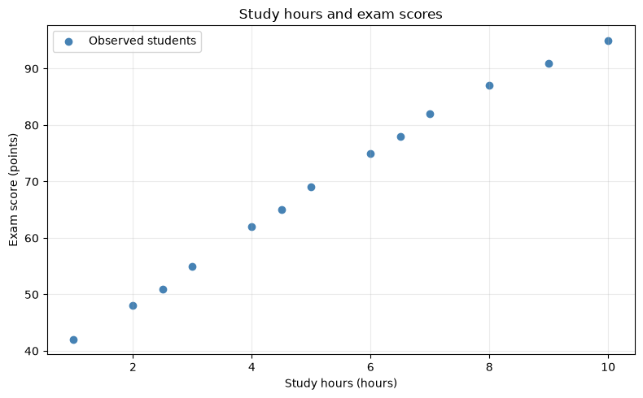
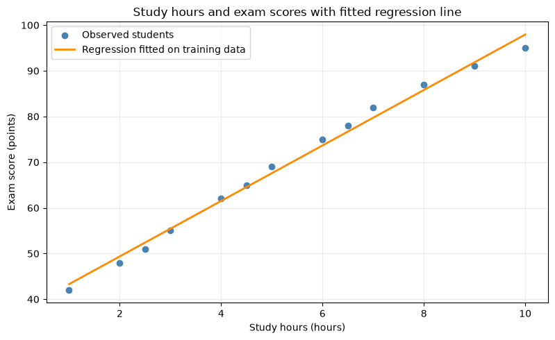

# Student Exam Performance Predictor

Individual Assignment 1: explore how study hours relate to exam scores, build a simple Linear Regression model, and evaluate its predictions.

**[Open the complete Jupyter notebook](Student_Exam_Performance_Predictor.ipynb)** for the code, saved outputs, plots, and explanations. All 19 code cells were executed successfully in a fresh Python 3 kernel. The 13 observations supplied in the assignment are included directly in the notebook; no separate dataset or download is needed.

## Notebook sections

1. Project definition and SDLC plan
2. Numerical data setup and basic statistics
3. Structured dataset and data inspection
4. Exploratory visualization
5. Linear Regression model
6. Model evaluation and practical prediction
7. Final project conclusion and technical quality

## Method and results

The model uses `StudyHours` to predict `ExamScore`. The reproducible split uses `test_size=0.2` and `random_state=42`, giving **10 training observations and 3 test observations**. The model is fitted only to the training set.

| Result | Value |
|---|---:|
| Learned slope | 6.0713 score points per study hour |
| Learned intercept | 37.2329 score points |
| Test mean absolute error (MAE) | 1.4823 score points |
| Predicted score for 7.5 study hours | 82.77 points |

Values are rounded for display. MAE is an error measured in score points, not an accuracy percentage.

### Study hours and observed scores



### Fitted regression line



## Limitations

This is a small educational prototype with one predictor and only three test observations. The association does not establish causation, and performance may change on new students. Predictions within the observed 1–10 hour range remain uncertain. Extrapolating to 100 hours produces an implausible estimate of about 644.36 points because the linear model has no built-in score limit. A larger, more representative dataset and additional predictors would be needed before practical use.

## Run the notebook

The notebook was tested with Python 3.12.14. `requirements.txt` pins the four libraries used by the code.

1. Download or clone this repository and open a terminal in its folder.
2. Install the dependencies, preferably in a virtual environment:

   ```bash
   python -m pip install -r requirements.txt
   ```

3. Open `Student_Exam_Performance_Predictor.ipynb` in Jupyter or Google Colab, then restart the kernel/session and run all cells in order. To install and launch Jupyter locally if needed:

   ```bash
   python -m pip install notebook
   python -m notebook Student_Exam_Performance_Predictor.ipynb
   ```

The saved outputs can be reviewed without rerunning the code. An [HTML reading copy](Student_Exam_Performance_Predictor.html) is also included: download the file and open it in a browser. GitHub normally displays its HTML source rather than rendering the page.

## Sources

The assignment brief supplies the dataset and requirements. The notebook includes links to the official NumPy, Pandas, Matplotlib, and scikit-learn documentation used for method checks, as well as the [shared course resource repository](https://github.com/amerbarhoush-dot/data-science-mbzuai).
